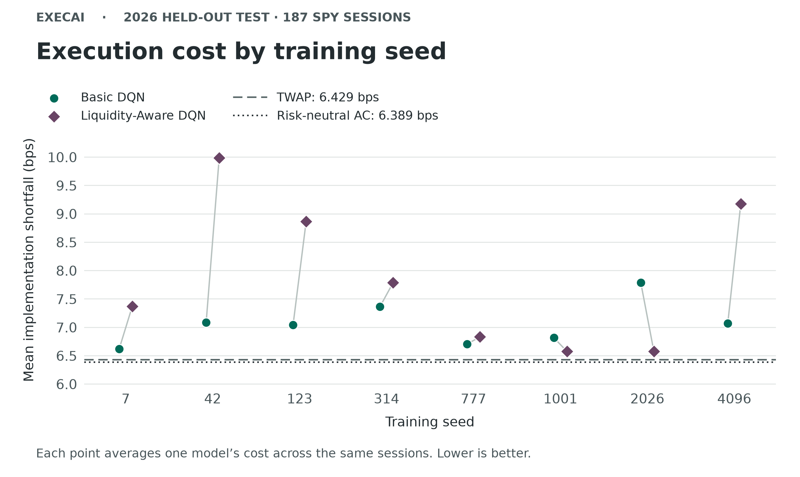
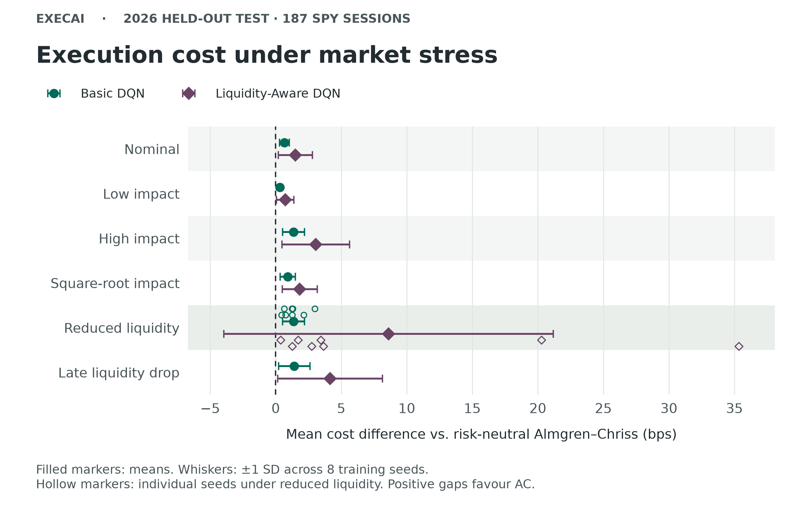

# ExecAI

### Optimal Trade Execution Using Reinforcement Learning

ExecAI is a solo project I developed with the intent of investigating whether reinforcement learning could learn an effective trading schedule for a large stock order, and how its decisions would compare with traditional execution strategies.

The problem is to sell 10,000 shares of SPY within one hour, divided into twelve five-minute intervals. At each interval, the agent decides how much of the remaining order to sell. Its objective is to minimize implementation shortfall, which measures the cost of executing the order relative to its initial market value.

I built a trading simulator for this problem, implemented Q-learning and Deep Q-Network (DQN) agents and evaluated their decisions using historical SPY prices. The final experiments also examine how trained policies behave when the assumptions about trading costs or available liquidity change.

## How it works

The simulator divides the 10,000-share order into 20 lots of 500 shares. An agent can choose how many lots to sell at each decision, including waiting if it expects a better opportunity. Any shares remaining at the final interval must be sold to meet the deadline.

Execution prices account for a bid-ask spread, transaction fees and temporary market impact. I implemented both linear and square-root impact models, with the option to vary market liquidity across the execution window.

I started with tabular Q-learning before moving to DQN using PyTorch. The DQN learns from stored execution experiences through experience replay and uses a separate target network during training. Invalid actions are excluded so the agent cannot sell more shares than it owns.

I developed two DQN configurations:

- **Basic DQN:** Uses the current time step and remaining inventory to select an action.
- **Liquidity-aware DQN:** Also observes the current relative market liquidity.

I trained both configurations using eight independent random seeds. Training ran for 2,000 episodes per model with validation every 200 episodes to identify the best-performing checkpoint. This was necessary because some networks performed well during training but deteriorated after further updates.

For comparison, I implemented immediate execution, Time-Weighted Average Price (TWAP) and a Volume-Weighted Average Price (VWAP) schedule based on historical volume forecasts. I also implemented a discrete Almgren–Chriss optimizer, including a version that penalizes the risk of holding inventory while prices change.

## Historical market data

I collected five-minute SPY price and volume data from Alpaca's SIP market data feed, covering January 2023 through September 2026.

The completed dataset contains 939 trading sessions and 72,954 five-minute bars. I checked the records against the NYSE trading calendar, including shortened trading sessions, and verified that the expected observations were present.

The data was divided chronologically:

| Dataset    | Period                 | Trading sessions |
| ---------- | ---------------------- | ---------------: |
| Training   | 2023–2024              |              502 |
| Validation | 2025                   |              250 |
| Final test | January–September 2026 |              187 |

I used the training period to estimate five-minute price volatility and a typical intraday trading-volume profile. These estimates were used to generate synthetic price paths for reinforcement learning and to provide volume forecasts for the execution strategies.

The 2025 data was used during development and historical validation. I kept the 2026 data separate until the model checkpoints and evaluation procedure were finalized.

Historical prices are observed market data. The transactions are simulated, with execution costs calculated using the project's assumed impact models. No trades were placed in a live market.

More information about the data collection process is available in [Historical Market Data](docs/data_source.md).

## Experimental results

I first verified that DQN could learn a known optimal solution in a deterministic environment. On the full 10,000-share problem with constant prices, the trained DQN matched TWAP's optimal execution cost of 7.8 basis points after 2,000 episodes. Performance was less consistent when I introduced changing market conditions.

### Historical evaluation

The following results compare the trained policies on the 2025 validation data and the held-out 2026 dataset. DQN results are averaged across the eight training seeds.

| Execution strategy            | 2025 validation | 2026 final test |
| ----------------------------- | --------------: | --------------: |
| Immediate execution           |         20.3332 |         20.3332 |
| TWAP                          |          5.6426 |          6.4293 |
| VWAP                          |          5.6461 |          6.4315 |
| Almgren–Chriss (risk-neutral) |          5.6250 |          6.3893 |
| Basic DQN                     |          6.2275 |          7.0598 |
| Liquidity-aware DQN           |          6.9472 |          7.8941 |

*Mean implementation shortfall in basis points (bps). Lower values indicate better execution performance. Results use the nominal linear-impact model and forecast liquidity.*

Both DQN configurations learned workable execution policies although neither consistently outperformed the traditional strategies. Basic DQN generally produced lower costs than the liquidity-aware version and showed less variation between independently trained models.

The pattern remained similar on the held-out 2026 data. Basic DQN averaged 0.6305 bps more than TWAP, while liquidity-aware DQN averaged 1.4648 bps more. I also calculated paired confidence intervals using bootstrap resampling across training seeds and trading sessions. These intervals are exploratory, particularly because only eight independent training runs were available.



*Mean execution costs across eight independently trained DQN models on the 2026 test dataset.*

### Market stress experiments

I evaluated the saved models under six market scenarios, including higher impact costs, square-root impact and periods of reduced liquidity. The models were kept unchanged throughout these experiments.

The liquidity-aware DQN was particularly sensitive to changes in available liquidity. On the 2026 test data, it averaged 16.7518 bps under uniformly reduced liquidity, compared with 9.5020 bps for basic DQN.

I investigated this behaviour using the 2025 validation sessions. Under reduced liquidity, the liquidity-aware models trained with seeds 1001 and 4096 postponed 70% and 90% of their orders until the final interval. The resulting large trades incurred substantial simulated market-impact costs.

The basic DQN was more consistent across the tested scenarios. Its trading decisions do not depend on observed liquidity, which limits its ability to react to changes but also avoids some of the poor responses learned by the liquidity-aware models.



*Additional execution cost relative to risk-neutral Almgren–Chriss on the 2026 dataset. Error bars represent one standard deviation across eight training seeds.*

These experiments suggest that giving an agent more market information can make its learned behaviour harder to generalize. The liquidity-aware DQN sometimes found effective schedules but several trained networks reacted poorly when the evaluation conditions differed from those encountered during training.

## Running the project

### Requirements

ExecAI uses Python 3.10 or newer. I developed and tested the project on macOS using Python 3.14, with PyTorch for the DQN implementation.

Clone the repository and create a virtual environment:

```bash
git clone https://github.com/jordxnsenan/optimal-trade-execution.git
cd optimal-trade-execution

python3 -m venv .venv
source .venv/bin/activate
python -m pip install -e .
```

### Run the tests

The project uses Python's built-in `unittest` framework.

```bash
python -m unittest discover -s tests -v
```

The tests cover the simulator, training components, execution policies and experiment scripts. GitHub Actions also runs the committed test suite on pushes and pull requests.

### Try the DQN benchmark

The deterministic benchmark can be run without downloading historical market data:

```bash
python -m scripts.training.benchmark_dqn \
  --full-size \
  --episodes 2000 \
  --seed 42
```

This trains a DQN on the full-sized execution problem and compares its learned schedule against immediate execution and TWAP.

The smaller benchmark is available by omitting `--full-size`.

### Historical data and model checkpoints

Historical experiments require the SPY dataset under `data/raw/SPY_5min_SIP/`. The raw data is excluded from Git because it comes from an external market data provider.

To collect the data, create a `.env` file based on `.env.example` and enter your Alpaca API credentials. Access to the required SIP feed is necessary.

```bash
python -m scripts.data.download_market_data \
  --start 2023-01-01 \
  --end 2026-09-30
```

The downloader saves individual trading-session checkpoints and can skip sessions that have already been downloaded successfully.

The repository includes the training-derived market calibration in `configs/spy_training_calibration.json`.

The original saved DQN checkpoints are kept locally under `results/models/` and are not included in the repository. To train and save a new pair of models:

```bash
python -m scripts.training.compare_dqn_liquidity \
  --episodes 2000 \
  --evaluation-episodes 250 \
  --seed 42 \
  --save-checkpoints
```

This saves a basic and liquidity-aware checkpoint for the chosen seed. The reported eight-seed experiments used seeds `7, 42, 123, 314, 777, 1001, 2026, 4096`.

### Historical evaluation

After preparing the historical data and all sixteen checkpoints, verify the saved models:

```bash
python -m scripts.analysis.audit_final_checkpoints
```

Evaluate the frozen policies on the 2025 validation dataset:

```bash
python -m scripts.evaluation.evaluate_dqn_final \
  --split validation
```

The final test command uses the separate 2026 dataset:

```bash
python -m scripts.evaluation.evaluate_dqn_final \
  --split test \
  --confirm-held-out
```

The held-out evaluation requires explicit confirmation and refuses to overwrite an existing final-results file. The reported 2026 experiment was performed using checkpoints selected before examining the test period.

To analyze an existing final-results CSV:

```bash
python -m scripts.analysis.analyze_dqn_robustness \
  --input results/final/2026_held_out.csv \
  --output-dir results/final/analysis \
  --expected-sessions 187
```

The analysis generates separate summaries for each training seed, scenario-level results, aswell as paired confidence intervals.

Plots can then be generated with:

```bash
python -m scripts.analysis.plot_dqn_robustness \
  --input-dir results/final/analysis \
  --output-dir results/final/figures
```

## Repository structure

I organized the code so that the simulator and learning algorithms remain separate from the scripts used to run experiments.

```text
optimal-trade-execution/
├── configs/
│   └── spy_training_calibration.json
├── docs/
│   └── experiments/
├── scripts/
│   ├── analysis/
│   ├── data/
│   ├── evaluation/
│   └── training/
├── src/
│   └── execai/
│       ├── agents/
│       ├── data/
│       ├── environment/
│       ├── evaluation/
│       └── policies/
├── tests/
│   ├── agents/
│   ├── commands/
│   ├── data/
│   ├── environment/
│   ├── evaluation/
│   └── policies/
├── results/
├── pyproject.toml
└── README.md
```

The main implementation is in `src/execai/`. The `scripts/` directory contains the runnable experiments and analysis commands. Tests are grouped by the component they cover.

The `results/` directory holds generated outputs and saved models locally. Selected figures are included in the repository and raw result CSVs and model checkpoints are excluded from Git.

Earlier development experiments are documented under `docs/experiments/`. Some of those notes record intermediate findings before the final eight-seed evaluation.

## Limitations

The execution simulator relies on assumed transaction costs and market-impact functions. Historical SPY prices provide realistic price movements, but the model cannot determine exactly how a hypothetical 10,000-share order would have affected the live market.

The basic DQN has a limited observation space. The liquidity-aware version can respond to an additional market feature although its performance varied substantially between training runs. The experiments also use synthetic training scenarios based on historical estimates which may not be entirely representative of every condition encountered in real trading.

The results show that DQN can learn the execution problem under controlled assumptions. For this particular setup, the traditional execution strategies produced lower average costs and more consistent performance on the historical test data.